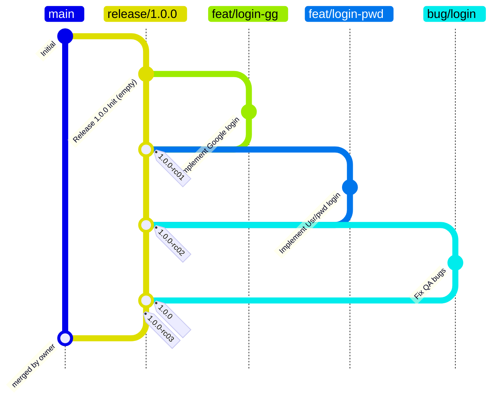
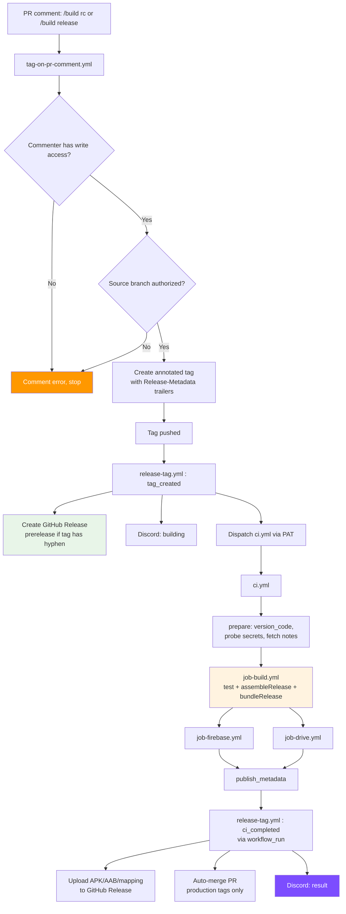
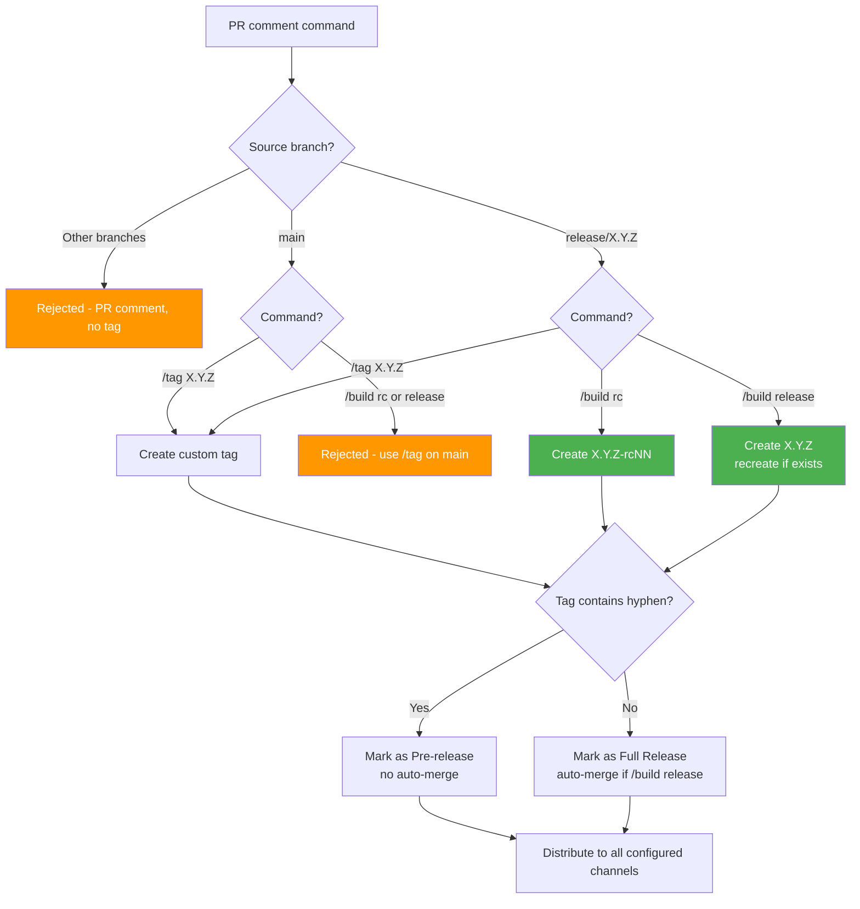
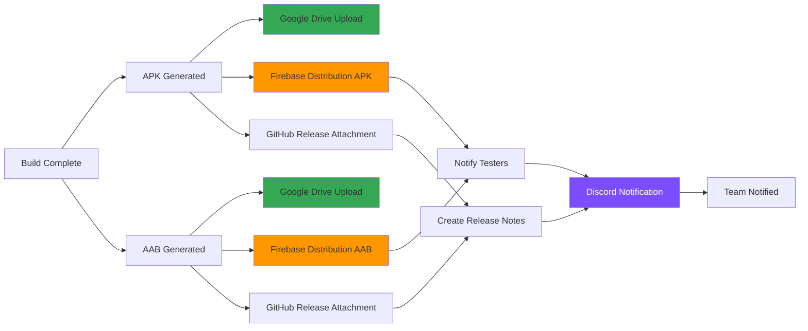
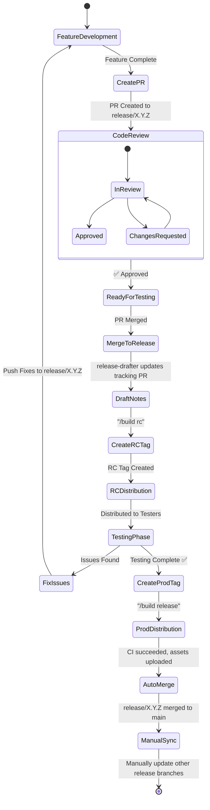
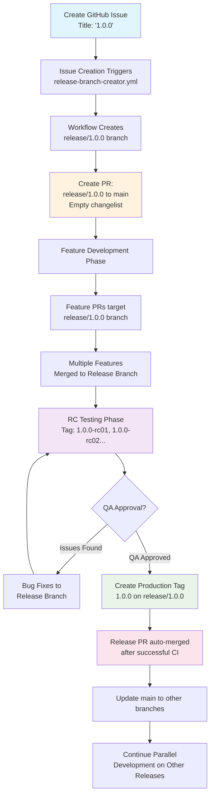
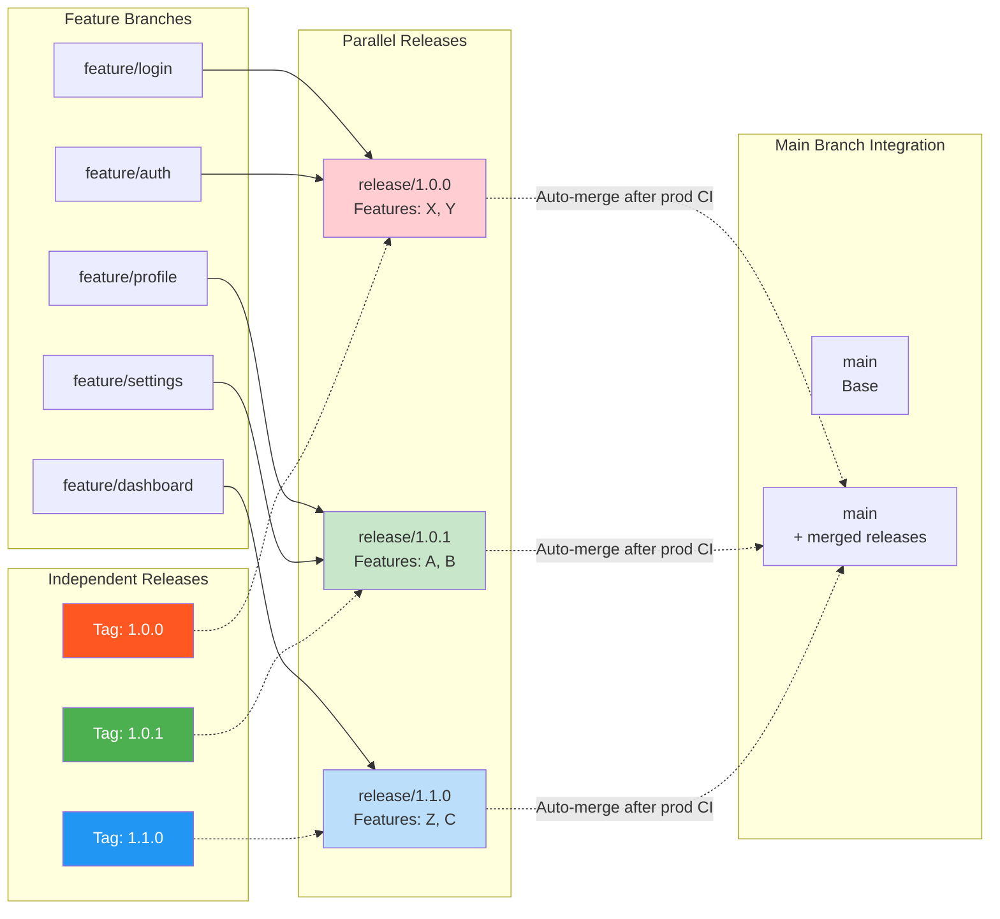

# GitHub Workflow Documentation

## Overview

This Android project implements a CI/CD pipeline on GitHub Actions built around a
feature-branch development model with pull request reviews and tag-based releases,
enhanced with **parallel release branch management** for concurrent release development.

Release builds are never triggered directly by a push or a PR. Every release build is
dispatched by `release-tag.yml` in response to a tag, and every tag is created by
`tag-on-pr-comment.yml` in response to a PR comment.

## Visual Workflow Diagrams

### Git Flow Strategy

- `main`: prohibit push, commit, PR only
- `release/*.*.*`: prohibit push, commit, PR only
- other branches: no restriction

These are conventions enforced by **branch protection settings you configure manually**,
not by any workflow.



- The commit tagged `1.0.0` is the same commit as `1.0.0-rc03`. It is drawn as a separate
  commit only because Mermaid cannot render two tags on one commit.
- **Important**: When a release branch is merged into main, all other active release
  branches should be manually updated with those changes to maintain consistency.

### CI/CD Pipeline Flow



---

## Tag Creation from PR Comments

### Branch Authorization

Tags can only be created from PRs where the **source branch** (head branch) follows these
patterns:

- `main` — main development branch
- `release/X.Y.Z` — release branches (e.g., `release/1.0.0`, `release/2.1.3`)

The PR's target branch (base branch) can be any branch. The tag is created on the PR's
head commit.

### Command Types

1. **Smart RC Command**: `/build rc`
    - Only works on `release/X.Y.Z` branches (rejected on `main`)
    - Automatically determines the next RC number (`1.0.0-rc01`, `1.0.0-rc02`, ...)
    - Fails if that RC tag already exists

2. **Production Release Command**: `/build release`
    - Only works on `release/X.Y.Z` branches (rejected on `main`)
    - Creates a production tag using the branch version (e.g., `1.0.0`)
    - If the tag already exists it is **deleted and recreated** at the PR's head commit
    - Sets `Auto-Merge-After-CI: true`, so the tracking PR is merged once CI succeeds

3. **Legacy Tag Command**: `/tag X.Y.Z-suffix`
    - Works on any authorized branch (`main` or `release/X.Y.Z`)
    - Creates a custom tag with the specified version

> **Note:** There is no requirement that a production tag sit on a commit that already
> carries an RC tag. The workflow contains a validation step for this, but it always
> passes — RC validation is advisory only.

### Examples

```
Source Branch: release/1.0.0 → Target Branch: main
Comment: /build rc → Creates tag: 1.0.0-rc01 on release/1.0.0

Source Branch: release/1.0.0 → Target Branch: main
Comment: /build release → Creates tag: 1.0.0 on release/1.0.0

Source Branch: main → Target Branch: develop
Comment: /tag 2.0.0-beta1 → Creates tag: 2.0.0-beta1 on main
```

### Release Strategy Decision Tree



### Distribution Workflow



### Development Lifecycle



## Parallel Release Branch Strategy

### Overview

Multiple releases can be developed simultaneously. Each release gets its own long-lived
branch that evolves independently, allowing teams to work on different feature sets for
different releases in parallel.

### Release Branch Lifecycle



### Branch Hierarchy & Merge Strategy



## Workflow Files

### 1. Release Branch Creator (`release-branch-creator.yml`)

**Triggers:** GitHub issues (opened), manual workflow dispatch.

**Functionality:**

- **Issue Detection**: Triggers when the issue title matches a semantic version pattern
  (e.g. `1.0.0`). Titles containing spaces or lacking a `.` are ignored.
- **Commit Hash Support**: reads `Base commit: <ref>` from the issue description
  (accepts commit hashes, branch names, tags); defaults to `main`.
- **Branch Creation**: creates `release/X.Y.Z` from the specified ref with an empty
  initialization commit.
- **PR Generation**: creates a PR `release/X.Y.Z` → `main` with a tracking template,
  labels `release` / `tracking` / `release-drafter`, and milestone linking when
  triggered from an issue.

**Issue Description Format:**

```markdown
Base commit: abc1234
<!-- or -->
Base commit: main

Release planning details, feature list, timeline...
```

The PR body must retain the literal `## What's Changed` and `## 🔧 Release Information`
headings — `release-drafter.yml` replaces the region between them.

### 2. Release Drafter (`release-drafter.yml`)

**Trigger:** push to `release/*`.

Extracts `X.Y.Z` from the branch name, finds the open tracking PR into `main`, verifies
it carries one of the labels `release` / `tracking` / `release-drafter`, regenerates a
**draft** GitHub Release, and writes the generated notes into the PR body.

Categorisation is configured in `.github/release-drafter.yml` and driven by PR labels:
`feature`/`enhancement`/`feat`, `fix`/`bugfix`/`bug`, `documentation`/`docs`,
`dependencies`/`deps`, and a catch-all.

Drafts (not published releases) are used so several release branches can be in flight
concurrently.

### 3. Enhanced Tag Creation (`tag-on-pr-comment.yml`)

**Trigger:** comment created on a pull request, starting with `/build` or `/tag`.

**Functionality:**

- **Smart RC Creation** (`/build rc`): increments `-rc01`, `-rc02`, ... using the release
  branch name as the version prefix.
- **Production Release** (`/build release`): creates the production tag; deletes and
  recreates it at the head commit if it already exists.
- **Legacy Support** (`/tag X.Y.Z-rcN`): manual version specification.
- **Permission Validation**: only `write`, `maintain` or `admin` collaborators.
- **Source Branch Validation**: validates the PR's **head branch**, not the base branch.

**Tag metadata contract.** The annotated tag message ends with trailers consumed by
`release-tag.yml`:

```
Release-Metadata:
Source-PR: 123
Source-Branch: release/1.0.0
Command-Type: production
Auto-Merge-After-CI: true
Requested-By: someone
```

Renaming any of these keys breaks the `awk` parser in `release-tag.yml`.

**Security:**

- Verifies commenter permissions via the GitHub API before doing any work
- Requires `GH_PAT` — a tag pushed with the built-in `GITHUB_TOKEN`
  would not trigger `release-tag.yml`

### 4. Release Tag (`release-tag.yml`)

Two entry points in one file:

- **`push` to any tag** → job `tag_created`: reads the tag trailers, creates/updates the
  GitHub Release (pre-release when the tag contains a hyphen), sends the Discord "building"
  notification, and dispatches `ci.yml` **using the PAT** so that the dispatched run emits
  a `workflow_run` event on completion.
- **`workflow_run` on CI completion** → job `ci_completed`: downloads the CI artifacts,
  reads `release_metadata.env`, uploads `*.apk` / `*.aab` / `mapping.txt` / `resources.txt`
  to the Release, auto-merges the source PR when the tag was a production tag and everything
  succeeded, and sends the final Discord notification.

### 5. Main CI Pipeline (`ci.yml`)

**Trigger:** `workflow_dispatch` only.

**Inputs:** `version_name` (required), `git_ref` (required), `version_code`,
`source_pr_number`, `auto_merge_after_ci`.

**Jobs:**

- `prepare` — computes the version code (`run_number + VERSION_CODE_OFFSET` unless
  overridden), probes which distribution secrets exist, and fetches the GitHub Release
  body for use as release notes.
- `build` — calls `job-build.yml`.
- `upload_firebase` — calls `job-firebase.yml`, skipped when the Firebase secret is absent.
- `upload_drive` — calls `job-drive.yml`, skipped when either Drive secret is absent.
- `publish_metadata` — always runs; writes `release_metadata.env`, `release_notes.md`
  and `firebase_links.md` into the `ci-release-metadata-<version>` artifact.

`run-name: CI ${{ inputs.version_name }}` and `name: CI` are both load-bearing —
`release-tag.yml` matches the workflow by name and recovers the version by stripping the
`CI ` prefix from the run's display title.

### 6. Reusable Jobs

- **`job-build.yml`** — checkout the ref, JDK 21, Gradle, Android SDK, decode the keystore,
  write `google-services.json` if supplied, run `:app:testDebugUnitTest`, then
  `:app:assembleRelease :app:bundleRelease` with the version and signing properties.
  Uploads `apk-<tag>`, `aab-<tag>`, `mapping-<tag>` (1-day retention).
- **`job-firebase.yml`** — reads the Firebase app id from the committed `app/google-services.json`
  (skipping the `.dev` client), distributes every APK/AAB via a matrix, scrapes the tester
  share links and merges them into Markdown.
- **`job-drive.yml`** — matrix-uploads every APK/AAB to the configured Drive folder.

### 7. Supporting Workflows

- **`cache-warmer.yml`** — on push to `main`, runs `assembleDebug` to populate the Gradle
  and Android build caches so tag builds start warm.
- **`remove-old-artifacts.yml`** — daily at 01:00 UTC, deletes artifacts older than 1 day
  while keeping the 5 most recent.
- **`sync-template.yml`** — daily at 02:00 UTC, pulls changes from the repository named by
  the `TEMPLATE_SOURCE_REPO` variable and opens a PR labelled `template_sync`. The job
  skips itself entirely while that variable is unset. It runs `actions-template-sync`
  twice — `prechecks,pull`, then a hard reset to `FETCH_HEAD`, then `push,pr` — so the
  sync branch matches upstream exactly rather than carrying a merge commit. Because of that reset the PR is a plain git merge of the upstream branch into `main`, so the app repo must share history with the template (created by cloning, not by *Use this template*); `.templatesyncignore` only takes effect if the reset step is removed and the action runs its default copy flow.

  **`.templatesyncignore` decides what is protected in the copy flow.** Every path *not* listed there is
  overwritten on each sync. The shipped file protects `settings.gradle.kts`,
  `app/build.gradle.kts`, `app/src/**`, `.distribution/**` and `README.md`, while letting
  workflows, the Gradle wrapper and CI docs flow down from the template.

## Development Workflow

### Feature Development

1. Developer creates a feature branch from the target branch (`main` or `release/X.Y.Z`)
2. Implements changes with proper commits
3. Creates a pull request to the target branch
4. On merge into a release branch, `release-drafter.yml` refreshes the tracking PR notes

Note: there is currently **no automated check on feature PRs** — no test run, no lint, no
build. Add a PR workflow if you want gating. Unit tests run only inside the release build.

### Testing & Release Candidates

1. When ready for testing, an authorized team member comments `/build rc` on the tracking PR
2. `tag-on-pr-comment.yml` validates the source branch and creates the RC tag
3. `release-tag.yml` creates a prerelease and dispatches CI, which distributes to:
    - Firebase App Distribution (for testers)
    - Google Drive (for storage)
    - GitHub Releases (marked as pre-release)
4. Discord notifications inform the team of the new RC

### Production Release

1. Development is completed on the `release/X.Y.Z` branch
2. An authorized team member comments `/build release` on the tracking PR
3. The production tag is created (recreated at head if it already exists)
4. CI builds and distributes to all configured channels
5. The GitHub Release receives the APK/AAB assets
6. The tracking PR is auto-merged into `main`
7. Discord announces completion

### Manual Builds

`ci.yml` can be dispatched directly from the Actions tab with a custom `version_name`
and `git_ref`. This builds and distributes but does not create a tag or a GitHub Release,
so asset upload and auto-merge do not apply.

## Security & Configuration

### Required Secrets

- `ANDROID_KEYSTORE_BASE64`: Android keystore for app signing
- `ANDROID_KEY_ALIAS`, `ANDROID_KEYSTORE_PASSWORD`, `ANDROID_KEY_PASSWORD`: keystore credentials
- `GH_PAT`: PAT (`repo` + `workflow`) for tag pushes and CI dispatch

### Optional Secrets

- `GOOGLE_SERVICES_JSON`: Firebase configuration
- `FIREBASE_DISTRIBUTION_CREDENTIAL_JSON`: Firebase service account
- `GG_DRIVE_CLIENT_ID`, `GG_DRIVE_CLIENT_SECRET`, `GG_DRIVE_REFRESH_TOKEN`, `GG_DRIVE_FOLDER_ID`: Google Drive (OAuth user account, uploads APK + AAB)
- `DISCORD_WEBHOOK`: Discord notifications

### Repository Variables

- `VERSION_CODE_OFFSET`: offset added to `run_number` for the version code
- `DISCORD_MENTION`: role/user mention prefixed to Discord notifications

Full setup instructions are in [SECRETS_SETUP.md](SECRETS_SETUP.md) and [TEMPLATE_SYNC_SETUP.md](TEMPLATE_SYNC_SETUP.md).

## Key Features

### Secret-Gated Distribution

Every distribution channel is probed at runtime and skipped when its credentials are
absent, so the same pipeline works in a repo with only signing secrets configured.

### Multi-Platform Distribution

- Firebase App Distribution for internal testing
- Google Drive for backup and sharing
- GitHub Releases for version management
- Discord integration for team notifications

### Traceability

Tag annotations record the source PR, source branch, command type and requester. The CI
metadata artifact carries the version, git ref, version code and per-channel results
forward to the finalization job.

## Best Practices Implemented

1. **PR-comment-driven releases**: tags are created through an audited, permission-checked path
2. **Branch-based authorization**: only `main` and `release/X.Y.Z` can produce tags
3. **Draft release notes**: parallel releases do not clobber each other
4. **Error handling**: failures reported via PR comments and Discord
5. **Traceability**: builds link back to commits, PRs and releases
6. **Automation**: minimal manual intervention required for releases

## Known Gaps

1. **No PR gating** — feature PRs run no tests, lint or build.
2. **No formatting check** — there is no Spotless/ktlint/detekt setup in this project.
3. **Release minification is off**, so no `mapping.txt` is produced. The upload step
   tolerates this via `if-no-files-found: ignore`.
4. **Branch protection is not automated** — configure `main` and `release/**` manually.
5. **Instrumented tests never run** in CI (no emulator job).
